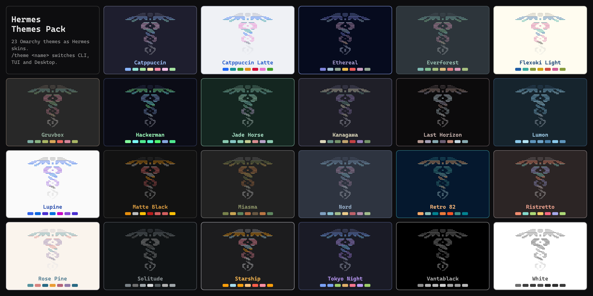

# Hermes Themes Pack



All Omarchy themes as Hermes skins, plus one command to switch them: `/theme`.
A skin is Hermes' single theme unit: the CLI, the TUI and the Desktop app all
repaint from it within a second. Optionally Hermes follows the Omarchy theme:
pick a theme in Omarchy and Hermes switches with it.

No core patches, monkeypatches, load-time side effects, network calls or remote
fonts. MIT licensed. Independent community package, not an upstream Hermes or
Omarchy product. Replaces the separate `hermes-tokyo-night` and
`hermes-jade-horse` packages.

Requires Hermes 0.22.5 or newer. Works without Omarchy too: the Omarchy parts
(`/theme omarchy`, `/theme follow`) are optional.

### Compared with Omarchy's own `omarchy` skin

Omarchy already renders one generic `omarchy` skin from the current theme. This
pack adds a separate, named skin for every theme (so all of them show up in
`/skin` and Desktop Appearance at once, also on machines without Omarchy),
hand-tuned Tokyo Night and Jade Horse skins, banner art recolored per theme, and
one `/theme` command that works in every Hermes surface.

## Commands

```
/theme                 current skin, Omarchy theme, follow state and the list
/theme <name>          switch every Hermes surface (e.g. /theme nord, /theme "Tokyo Night")
/theme omarchy         match the current Omarchy theme once
/theme follow on|off   follow Omarchy theme changes automatically
/theme install         install/update all pack skins without selecting one
/theme uninstall       remove the pack's managed skins (selection unchanged)
```

`/theme` works in the CLI, the TUI, the Desktop composer and messaging
gateways. The same verbs are available as `hermes theme ...` in a shell when
`plugins.isolation` is `in_process` (Hermes wires plugin CLI subcommands only
then); otherwise use `/theme` or `python3 ~/.hermes/plugins/hermes-themes-pack/installer.py`.

Switching always goes through Hermes' own writer
(`hermes config set display.skin <name>`), which updates the active profile and
makes the running gateway broadcast the change to every surface.

## Install

From the Hermes plugin catalog:

```sh
hermes plugins install hermes-themes-pack
hermes plugins enable hermes-themes-pack
```

Straight from GitHub:

```sh
hermes plugins install seppegadeyne/hermes-themes-pack --no-deps
hermes plugins enable hermes-themes-pack
```

Then in any session: `/theme nord`, or `/theme follow on`.

From a local clone use `hermes plugins install "file://$(pwd)" --no-deps`.
`--no-deps` keeps a plugin disabled until the explicit enable (the package has no
dependencies).

## Following Omarchy

`/theme follow on` installs a small hook at
`~/.config/omarchy/hooks/theme-set.d/50-hermes-themes-pack`. Omarchy runs it after
every theme switch with the theme slug; it calls this package's installer, which
selects the matching pack skin. A theme that is not in the pack (for example
`osaka-jade`, which ships no palette, or a theme you installed from git) falls
back to Omarchy's own generated `omarchy` skin. The hook does nothing when the
package is removed, and `/theme follow off` removes only an unmodified copy.

Following is per user, not per profile: Omarchy runs the hook without a
`HERMES_HOME`, so it always switches the default profile (`~/.hermes`) and does
nothing when the pack is not installed there. Other profiles can match Omarchy
with `/theme omarchy`.

Omarchy itself also writes an `omarchy` skin on every theme switch and activates
it only when Hermes is on `default`/`omarchy`, so it never overrides a pack skin.

## What it does on your system

What you should know before installing. Nothing happens at plugin load; every
change below is caused by a `/theme` command you run.

- Files written, only inside the active profile's `HERMES_HOME`:
  `skins/<name>.yaml` for the pack's 23 skins and the receipt
  `theme-packages/hermes-themes-pack.json`. Personal or edited skins with the
  same name are skipped, never overwritten (unless `install --replace`, which
  backs them up into the receipt and restores them on uninstall).
- Commands run: `hermes config set display.skin <name>` and
  `hermes config get display.skin` (Hermes' own config writer, 60-second
  timeout). The pack never edits `config.yaml` itself.
- Files read outside `HERMES_HOME`: `~/.local/state/omarchy/current/theme.name`
  (the current Omarchy theme) and the pack's own hook file below (to show the
  follow state), for `/theme`, `/theme omarchy` and `/theme follow`.
- Only with `/theme follow on`: one executable hook script at
  `$XDG_CONFIG_HOME/omarchy/hooks/theme-set.d/50-hermes-themes-pack`
  (default `~/.config/...`). Omarchy runs it on each theme switch; it runs
  `python3 ~/.hermes/plugins/hermes-themes-pack/installer.py omarchy <slug>`
  for the default profile (90-second timeout), which selects the skin through
  the first `hermes` on `PATH` (else `~/.local/bin/hermes`), and exits silently
  when the package is not installed there.
  `/theme follow off` removes it only if it is unmodified.
- No network calls, no background processes, no Hermes tools, hooks or
  middleware, no credentials, no telemetry, no self-updater. Updates come only
  through `hermes plugins update`.

## Themes

Every Omarchy stock theme with a palette (23). Desktop built-in names are avoided
because a backend skin with such a name never paints in the Desktop app:
`catppuccin` → `catppuccin-mocha`, `everforest` → `everforest-dark`.
Tokyo Night and Jade Horse use hand-tuned skins; the others are generated from
the theme's `colors.toml` with recolored banner art.

Add a theme: create `themes/<slug>/colors.toml` (copy an Omarchy theme's file),
optionally `skin.yaml` (hand-made, wins) and `meta.json`
(`{"skin": "...", "label": "..."}`), then run `python3 tools/build.py` and commit
`skins/`. The slug should equal the Omarchy theme slug so following works.

## Live repaint per surface

The TUI (`hermes --tui`) and the Desktop app repaint within a second after any
switch: `/theme`, `/skin`, `hermes config set display.skin` or an Omarchy follow.

The classic CLI (`hermes` / `hermes chat` without `--tui`) does not watch for
skin changes: it reads the skin at start-up, and only `/skin <name>` typed in
that same window repaints the prompt, rules and status bar there (the banner and
earlier output keep the old colors until the next start). So after `/theme`, an
Omarchy theme switch or a switch from another window, a running classic CLI
keeps its old colors. Start a new session, or run `/skin <name>` in it. This is
a Hermes core limitation that a plugin cannot fix through public APIs; upstream
tracks it in https://github.com/NousResearch/hermes-agent/pull/58932.

## Desktop

There is no separate desktop half: the Desktop app converts the active skin into
its own palette, so `/theme` (or Appearance) covers it. Light themes paint light.
Desktop appearance is per profile; a switch from `/theme` is applied to the
profile it runs in.

## Uninstall

```
/theme follow off
/theme uninstall
```

```sh
hermes config set display.skin default
hermes plugins remove hermes-themes-pack
```

The installer keeps a receipt at `$HERMES_HOME/theme-packages/hermes-themes-pack.json`.
It never overwrites a personal skin with the same name (`/theme install --replace`
backs it up and restores it on uninstall), and it leaves skins you edited alone.

## Development and tests

```sh
python3 tools/build.py
~/.hermes/hermes-agent/venv/bin/python tools/preview.py   # docs/ images (needs Chromium)
python3 -m unittest discover -s tests -v
HERMES_REPO=/path/to/hermes-agent "$HERMES_REPO/venv/bin/python" tests/hermes-integration.py
hermes plugins validate .
```

The integration test uses a temporary `HERMES_HOME` and `XDG_CONFIG_HOME`.

## Changelog

- 1.1.1: README documents that a running classic CLI does not repaint on a
  skin switch (Hermes core, upstream PR #58932); the TUI and Desktop do.
- 1.1.0: declare `requires_hermes >=0.22.5`; catalog banner and screenshots
  (`docs/`, rendered from the skins by `tools/preview.py`); README disclosure;
  `follow on` notes that the hook switches the default profile; a hung
  `hermes config` call reports an error instead of a traceback; `--replace`
  applies only to `install`; uninstall ignores unknown receipt names.
- 1.0.0: 23 Omarchy skins, `/theme`, Omarchy follow hook.

## Credits

Palettes from the Omarchy stock themes by David Heinemeier Hansson and theme
contributors (MIT), https://github.com/basecamp/omarchy. Jade Horse:
https://github.com/dhh/omarchy-jade-horse-theme.
